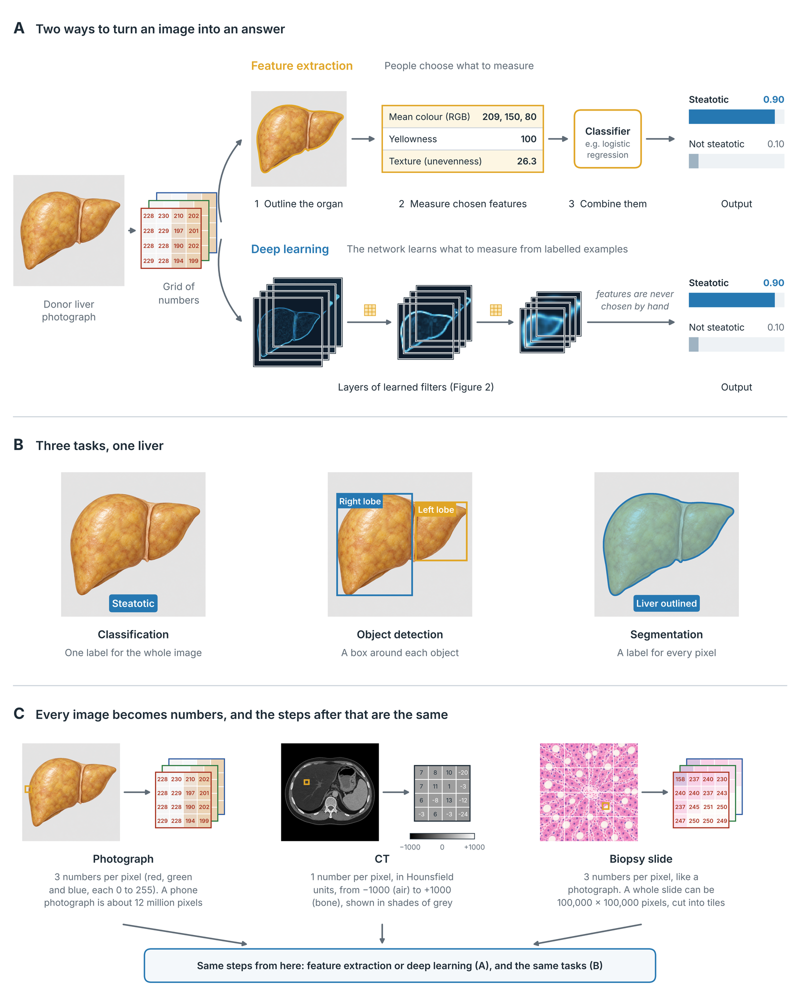
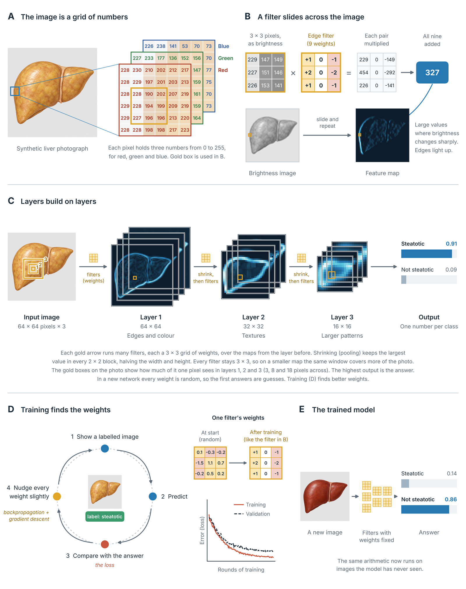

# How a computer sees a donor liver

An interactive companion to the Transplant International article
*Decoding AI for transplantation: how computers see* (Decoding AI for Transplantation series).

**Open the tool:** https://geokour.github.io/cnn-liver-explorer/

Five steps from an image to an answer, worked through on a photograph, a CT slice
or a biopsy slide of a steatotic and a non-steatotic donor liver:

1. Pixels: the image as a grid of numbers
2. A filter: one convolution, worked by hand
3. Layers: feature maps, pooling and receptive fields
4. Training: a real, very small convolutional network trained in your browser
5. The trained model: fixed weights classifying an image

Everything runs in the browser. Nothing is uploaded.

## Video

https://github.com/user-attachments/assets/a113f89e-97d3-451c-8a68-a38dc274ac99

[Download the video (MP4, 1080p)](media/inside_a_cnn.mp4)

## Figures

**Figure 1.** Two ways a computer can assess a donor liver image, three tasks, and three kinds of image.

**Figure 2.** Inside a convolutional neural network.

## Notes

All six images are AI-generated illustrations (ChatGPT, gpt-image), not patient images.
CT Hounsfield values were assigned for teaching and are not measurements.
This is a teaching tool, not a clinical tool.

## Citation

TBC
